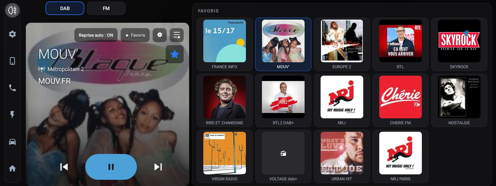
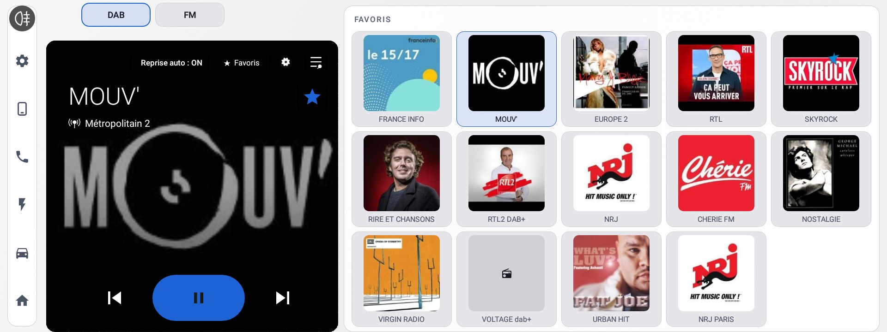
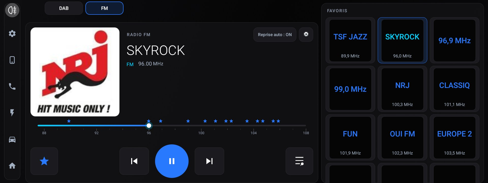

# MG4 Radio Dash — redesigned radio for the MG4 (fork of MG4-Radio-DABplus-Fix)

This fork restyles the stock SAIC radio app to match **[MG4Dash](https://github.com/Skittle6938/MG4Dash)** and adds favourites-only station switching. It keeps every fix from the original project ([MG4-Radio-DABplus-Fix](https://github.com/Skittle6938/MG4-Radio-DABplus-Fix), documented below).







*Screenshots taken on the car: DAB+ with the Immersive player and 5 columns of favourites (1.5.0, dark and light), FM with the dial and the favourite stations (1.4.0).*

### What's new in this fork

**1.5.0**
- **Immersive DAB+ player** (default): the station image covers a square player panel, extended by the colour of its edge when it is not square, with the title in white and a play button in the image's main colour, like the Android Auto player. It follows MG4Dash's *Player on the home screen* setting (Immersive or Classic, MG4Dash 1.5.1 or later); FM keeps its dial.
- **5 columns of square favourites** on DAB+, sized so that 3 full rows fit before scrolling.
- **★ Favourites window**: every DAB+ station received, alphabetically, with its logo and multiplex; one tap adds or removes a favourite. Favourites already chosen stay ticked, even out of range. *Refresh* asks the tuner for its latest station list.
- **Bigger DAB+ text** (30 sp on up to 3 lines instead of a single scrolling line), star next to the station name, playback buttons centred.

**Earlier**
- **Full-screen dark glass design**: the SAIC side bar and top banner are hidden (swipe from the left or top edge to bring them back), DAB / FM tabs as pills, the top-left corner is left free for MG's fog-light overlay button.
- **MG4Dash dock** at the bottom (clock, Home, Vehicle, Climate, Energy, Android Auto, Settings) to jump straight to the MG4Dash pages.
- **Large square station artwork**, the same image as on the home screen (DAB+ slideshow, with the per-station cache as fallback).
- **One favourites bar on the right**, 3 columns: the favourite stations of the current band with their image (DAB) or their RDS name in the theme colour above the frequency (FM/AM). One tap tunes the station. The old bottom row is gone and the central controls are bigger.
- **Favourites-only skipping**: the steering-wheel buttons and the ◀ ▶ buttons of the home screen now cycle through your favourites only (DAB and FM). Without favourites, the original behaviour is kept. The arrows inside the radio app are unchanged.
- **Modern FM dial** replacing the stock frequency ruler: gradient track, glowing cursor, small stars for favourites. Drag the cursor to tune.
- **Stars instead of hearts** for favourites, in the colour of the MG4Dash theme you chose.
- Restyled favourite cards, playback buttons (identical on FM and DAB) and frequency colours.
- **Follows the MG4Dash theme** (background and button colour chosen in MG4Dash 0.8 settings): the radio recolours itself the next time it opens.
- **Light mode** (MG4Dash 0.9.4 or later): when MG4Dash is light, or in Auto during the day, the radio uses light backgrounds with dark text and icons, and switches back to dark when the car's lights come on.

### How it is built

The redesign is applied on top of `apk/Radio_patched_signed.apk`:
- `dash/` — modified layouts (all original view IDs kept), drawables, colours and two smali files (`RadioService$6` for favourites skipping, `RadioMainActivity` for three lifecycle hooks);
- `helper/src/` — a small Java module (`RadioDash`, `Favorites`, `FmDial`) compiled to smali and added to the app;
- `build.ps1` — compiles the module, decodes the base APK, applies `dash/`, rebuilds and signs with the AOSP platform test key (not included: see MG4Dash's README to download it).

Install exactly like the original patch below (`adb push` + `pm install -r -f`, or USB stick), then **reboot the head unit**. To go back, reinstall the original `Radio_patched_signed.apk`, or `adb shell pm uninstall com.saicmotor.radio` for the factory radio.

---

# MG4 Radio — DAB+ Slideshow Art on Launcher + Auto-Resume

Patch for the SAIC MG4 (EH32 LL firmware) head unit that:
1. Fixes missing **DAB+ station artwork** on the stock launcher home screen.
2. Adds **automatic radio resume** when the car starts — the radio plays again on its own, without opening the app.
3. Keeps **live metadata (artwork, text) flowing to the launcher even while paused**.


*Virgin Radio artwork displayed live on the launcher home screen — song title included.*

---

> ## ⚠️ A REBOOT IS REQUIRED AFTER INSTALLING
>
> This is **not optional**. The radio runs as a system service that is already loaded in memory; the new APK only takes effect once the head unit restarts. After installing, **reboot the unit** (hold the Home button ~20 s until the screen turns off and it restarts). Until you reboot, you will keep running the old version and may think the patch "did nothing".

---

## What this fixes

### 1. DAB+ artwork on the launcher

On the stock MG4 head unit, when you listen to a DAB+ station that broadcasts artwork (station logo, album cover, show image…), the image appears correctly **inside the radio app** — but the launcher home screen always shows a generic placeholder instead of the actual artwork.

After this patch, **the artwork appears directly on the launcher home screen**, along with the station name and current song title, without having to open the radio app.

> **⏱️ Be patient with the image — 10–60 s is normal.** DAB+ stations only push their slideshow image periodically (typically every 10–30 s), and reception conditions add delay. So after a fresh start or a station change, the artwork can take **anywhere from ~10 to ~60 seconds** to appear or update, depending on signal quality and how often that particular station transmits images. A few stations send **no images at all** — this is rare, but when it happens there is nothing the patch can do. The per-station cache (below) makes already-seen stations show instantly.

### 2. Auto-resume on car start

If the radio was playing when you switched the car off, it now **starts playing again automatically** the next time you start the car — no need to open the radio app or press play.

- Controlled by an **on-screen toggle** added to the FM and DAB pages ("Auto-resume: ON / OFF"). Default is **ON**.
- If you **manually paused** the radio before switching off, it stays paused on the next start (your choice is respected).
- Works for both **FM/AM** and **DAB+**.


*The "REPRISE AUTO : ON" toggle added at the bottom-left of the radio page.*

**How it works:** at boot the car asks the radio to load as the active media source but in a *muted / paused* state (this is the stock behaviour — it's why the station name shows on the launcher but no sound plays). The patch intercepts that moment and, when auto-resume is enabled and the radio was playing at shutdown, routes it through the radio's normal tune-and-play path instead, so audio actually starts.

**Playing started from the steering wheel or the home screen also counts** (this fork): the "was playing" flag used to be updated only by the play button inside the radio app, so a radio started any other way was not resumed at the next start. A pause sent by the car at shutdown deliberately does not clear it.

### 3. Live metadata while paused

On the stock firmware, pausing the radio makes the launcher home screen **freeze or drop** the now-playing card — the artwork and text stop updating until you press play again.

After this patch, when you pause the radio the **artwork, song/programme text (DAB+ DLS) and FM RDS text keep updating live on the launcher**, exactly as if it were playing. Only the audio is muted.

**How it works:** pausing only mutes the audio — the tuner stays tuned and keeps decoding metadata. The stock code, however, called `MediaSession.setActive(false)` on pause, which removes the session from the system's *active* media session and stops the launcher from receiving further updates. The patch keeps the session **active** while paused (state still reported as `PAUSED`, so the play/pause button stays correct), so live metadata keeps reaching the launcher.

### Bonus: instant artwork on station switch

DAB+ stations only broadcast their slideshow image every 10–30 seconds. Without caching, you'd have to wait up to half a minute each time you switch stations for the image to appear on the launcher.

This patch also **remembers the last image received for each station** and restores it immediately the next time you tune to that station, so the artwork is visible right away. (The first time you ever hear a station, you still have to wait for its first broadcast — see the 10–60 s note above.)

### Image cropping

Some stations broadcast rectangular images with side bars (e.g. France Info). When the bars are a single uniform colour the patch **center-crops to a clean square**; otherwise it **letterboxes** the image onto a square canvas. Either way images fit the launcher widget correctly without distortion.

---

## How it works (technical)

### DAB+ artwork

The stock radio app receives slideshow bitmaps via `onDabSlideShowChanged()` in `RadioService$DabTunerCallback` and forwards them to its own UI — but never publishes them to the Android `MediaSession` (`ALBUM_ART` metadata key). The launcher reads artwork exclusively from `MediaSession`, so it never received anything.

**This adds:**
- Forward of each received bitmap to `MediaSession` via `IRadioMBSCallback.setSessionMetadataDabBitmap()`
- Per-station disk cache (`dab_<serviceId>.jpg`) — saved on receive, restored on tune
- Uniform-colour side-bar crop to square, with letterbox fallback for non-uniform bars
- Proper synchronization (`synchronized(mMBSCallbacks)`) and null-guards matching the existing code patterns

### Auto-resume

At boot the car sends `RadioService.onStartCommand()` a "resume as source" command (event `0x8006`), which the stock code handles via `resumeOnlySource()` / `resumeDabOnlySource()` — these deliberately `mute(true)` and set the session to **PAUSED** (source loaded, silent). That is why the launcher shows the station name but nothing plays.

**This adds:** a gate at the top of `resumeOnlySource()` / `resumeDabOnlySource()` — when the **Auto-resume** preference is ON **and** the radio was playing at shutdown, it instead calls the radio's existing `resumeTunerChannel()` / `resumeDabTunerChannel()` (full tune + `PLAYING` state) so audio actually starts. The preference and last-playing state are persisted in `RadioSharedPreference`; the on-screen toggle and play-state tracking live in the FM/DAB presenters and fragments.

### Live metadata while paused

Pausing routes through `RadioMBService.toSetSessionPlaybackStatePaused()`, which set the playback state to `STATE_PAUSED` **and** called `MediaSession.setActive(false)`. An inactive session is no longer the system's active media session, so the launcher stops receiving metadata/art updates even though the tuner is still decoding them (pause = `RadioTuner.setMute(true)` only — the tuner stays tuned).

**This removes** the `setActive(false)` call on pause. The state is still reported as `STATE_PAUSED` (correct play/pause button, audio stays muted), but the session stays **active**, so the existing slideshow/DLS/RDS forwarding (which already runs with no play-state condition) keeps the launcher's artwork and text live.

Everything is contained in the **radio APK** — the launcher APK is untouched. See [`patches/radio/`](patches/radio/) for the exact modified smali and resource files.

---

## Installation

### Option A — Direct APK install (recommended)

1. Download **[Radio_patched_signed.apk](https://github.com/Skittle6938/MG4-Radio-DABplus-Fix/raw/main/apk/Radio_patched_signed.apk)**
2. Copy it to a USB stick and plug it into the head unit's USB port
3. Open the APK with the built-in file manager to install it

> **⚠️ A REBOOT IS REQUIRED after installation — this is not optional.** Hold the Home button for approximately 20 seconds until the screen turns off and the unit restarts. Until you reboot, the old version keeps running and the patch will appear to do nothing.

### Option B — ADB over USB

ADB is disabled by default on the MG4 head unit. You need to enable it first using **ADB_util**, a tool developed by Leon Kerman:

> [XDA thread — MG4 Electric AAOS 9 playing (and possibly other MG models)](https://xdaforums.com/t/mg4-electric-aaos-9-playing-and-possibly-other-mg-models.4697712/post-90591053)

Once USB debugging is enabled:

1. Connect a USB cable between your PC and the head unit
2. Run:
   ```bash
   adb push Radio_patched_signed.apk /data/local/tmp/radio_patch.apk
   adb shell pm install -f /data/local/tmp/radio_patch.apk
   ```
   The `-f` flag is required to replace the system app with the patched version.

> **⚠️ A REBOOT IS REQUIRED after installation — this is not optional.** Hold the Home button for approximately 20 seconds until the screen turns off and the unit restarts. Until you reboot, the old version keeps running and the patch will appear to do nothing.

---

## Reverting

```bash
adb shell pm uninstall com.saicmotor.radio
```
The system original under `/system/priv-app/Radio_eh32_ll/` is restored automatically.

---

## Firmware compatibility

Tested on: `Radio_eh32_ll`  
Check your version before installing:
```bash
adb shell dumpsys package com.saicmotor.radio | grep versionName
```
